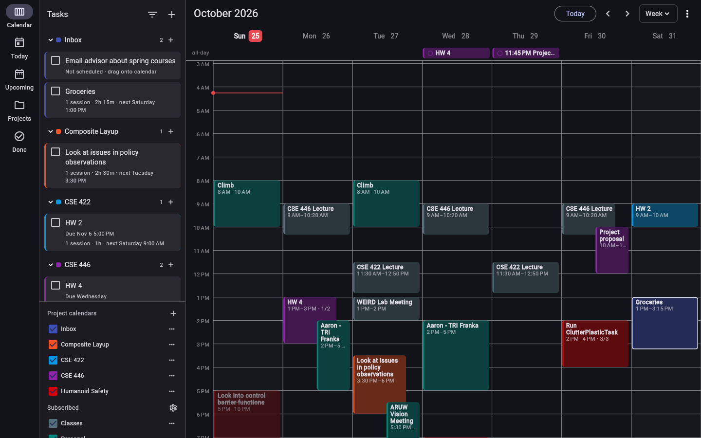

# Taskflow

A minimal, fast task list and planner for macOS and Android, synced through Firebase Firestore.



- **Calendar** (Mac / wide windows): see "Calendar planner" below
- **Today**: overdue tasks, tasks due today, and work sessions scheduled today
- **Upcoming**: the next 7 days, each showing what's due and what's scheduled that day, then Later and Unscheduled
- **Projects**: open tasks grouped by project (no project = Inbox). Projects are kept until you delete them, even with no open tasks. The folder button adds a new, empty project; **+** next to a project adds a task to it, and **⋯** renames, recolors or deletes it. Deleting a project moves its tasks to the Inbox.
- **Done**: the 50 most recently completed tasks, which you can reopen
- **Calendars**: classes and events from any iCal feed (Google, iCloud, Outlook, Canvas) appear on Today and Upcoming, interleaved with tasks by time. Tap an event to see details or to add a task for it. The event name becomes the task's project, so an assignment for "CS 201" files itself under that class.
- Works offline. Firestore caches everything locally, so edits are instant and sync when you're back online.
- ⌘N / Ctrl+N creates a new task.

## One-time setup

You'll need [Flutter](https://docs.flutter.dev/get-started/install/macos), Xcode (for the Mac app), and Android Studio or the Android SDK (for the phone app).

### 1. Create the Firebase project
1. Go to <https://console.firebase.google.com>, then **Add project**. Google Analytics isn't needed.
2. Open **Build → Authentication → Get started**, and enable **Email/Password**.
3. Open **Build → Firestore Database → Create database**. Choose **production mode** and a region near you.
4. In the **Rules** tab of Firestore, paste the contents of `firestore.rules` and click **Publish**. If you published an older version that only covered `tasks`, publish again: calendar settings need the updated rules.

### 2. Connect the app to it
```sh
dart pub global activate flutterfire_cli
npm install -g firebase-tools   # or: curl -sL https://firebase.tools | bash
firebase login
cd taskflow
flutterfire configure --platforms=android,macos
```
This replaces the placeholder `lib/firebase_options.dart` with your project's settings and adds `android/app/google-services.json`.

### 3. macOS signing (required for sign-in to work)
Firebase Auth stores your login in the macOS keychain, which requires a signed app:
1. `open macos/Runner.xcworkspace`
2. Select **Runner → Signing & Capabilities**, then pick your Apple ID under **Team**. A free personal team works.

The keychain and network entitlements are already set in `macos/Runner/*.entitlements`.

### 4. Run it
```sh
flutter run -d macos            # Mac
flutter run -d <android-device> # phone connected over USB with USB debugging on
```
Create an account on one device, then sign in with the same email on the other.

### Installing for everyday use
- **Mac:** `flutter build macos --release`, then copy `build/macos/Build/Products/Release/taskflow.app` to `/Applications`.
- **Android:** `flutter build apk --release`, then install `build/app/outputs/flutter-apk/app-release.apk` on the phone. Or run `flutter install` with the phone connected.

## On Android
**Calendar tab:** the same planner as on the desktop, made for fingers. It opens on 3 days by default; switch to 1 day or the week in the toolbar.
- **Change days:** swipe sideways. The calendar follows your finger and snaps to the nearest day, so a short swipe moves one day.
- **Move a block:** long-press it, then drag. A plain drag scrolls.
- **Resize a block:** tap it to select it, then drag the handles at its top and bottom edges.
- **Block actions:** tap a selected block for Edit task, Mark done, Add another session and Delete session.
- **New session:** long-press empty space for an hour, or keep dragging to set the length.
- **Schedule a task:** the tray along the bottom lists your open tasks, unscheduled ones first. Long-press one and drag it up onto the calendar. Tap a task to edit it.

**Home screen widget:** long-press your home screen, choose Widgets, then **Taskflow**.
- **What it shows:** your next 7 days, i.e. work sessions, deadlines and events from subscribed calendars, in their colors. Today also lists overdue tasks and hides what has already ended. Tap it to open the app.
- **When it updates:** whenever the app changes anything, and about every 30 minutes in the background (Android doesn't allow more often than every 15). Changes made on the Mac show up without opening the phone app.
- **Before the first update:** sign in on the phone once. If the widget says "Open Taskflow to load your agenda", open the app once.
- **If it stops updating:** some phones (Samsung, Xiaomi and others) pause background work for apps you rarely open. Set battery usage for Taskflow to Unrestricted.

## Due dates vs. scheduled time
A task has two separate kinds of dates, and the task editor shows them in separate sections:
- **Due:** the deadline, optionally with a time. It shows in the calendar's all-day row and makes the task overdue once it passes.
- **Scheduled:** any number of work sessions, meaning when you plan to work on the task. Add, edit or remove them in the editor, or drag them around on the desktop calendar. A session after the due date is flagged.

On the phone, Today and Upcoming list each task on the days it's scheduled, as well as the day it's due. A task that's due and scheduled on the same day appears once.

## Calendar planner (desktop)
On the Mac (any window at least 700px wide), the app opens on the **Calendar** view, styled after Notion Calendar.

**Layout:** open tasks are on the left, grouped by project, with a week grid on the right. The ☰ button hides the task list to give the calendar more room. In narrow windows, overlapping events cascade, each shifted right a little, instead of being squeezed into unreadable slivers.

**Scheduling:**
- Drag a task onto the grid to schedule a one-hour **work session**.
- Drag the same task again to add more sessions. A task can be spread over as many sessions as you like. Each block shows "2/3", and the task card shows the count, total time and next session.
- Drag a block to move it, including to another day.
- Drag its top or bottom edge to change its length. Everything snaps to 15 minutes.
- Drag on empty space to draw a new block, then type a new task or pick an existing one.
- Drag a block back onto the task list to unschedule it. The session is removed, and the task stays.
- Dragging near the top or bottom edge scrolls the grid.

**Other interactions:**
- Click a block to select it. Double-click to edit the task. Right-click for a menu: mark done, add another session the next day, delete.
- Task deadlines show in the all-day row.

**Calendars:**
- Each project has its own calendar with a color and a show/hide checkbox, listed in **Calendars** at the bottom left.
- The folder button above the task list (or **+** next to **Projects** under Calendars) creates a project before it has any tasks. **⋯**, or right-clicking a project's heading, renames, recolors or deletes it; renaming updates its tasks and sessions too.
- Projects stay listed when all their tasks are done. A project you type into a task is saved the first time it's used.
- Subscribed iCal feeds are listed there as well.

**Keyboard:**

| Key | Action |
|---|---|
| ← / → | Previous / next week |
| T | Today |
| D / 3 / X / W | Day / 3 days / work week / week |
| Delete or Backspace | Remove the selected session (with undo) |
| Esc | Deselect |
| ⌘N | New task |

**Scrolling:** two-finger scrolling moves up and down through the day.

**Scrolling sideways:** swipe with two fingers, or use a horizontal scroll wheel or Shift+wheel. The calendar follows your fingers and snaps to the nearest **day** when you let go, so you can move a week view along one day at a time. A longer swipe or a flick moves several days, up to a week. The work week view moves a week at a time instead, since its days aren't consecutive.

**Zooming:** pinch on the trackpad (or with two fingers on the phone) to stretch or squish the hours. Fully squished, the whole day fits on screen; zoomed in, an hour can be about 3× its normal height. The time under your fingers stays in place.

**Jumping a whole page:** the ‹ › buttons and the arrow keys move a full week (or 3 days, or 1). **Today** brings back the normal Sunday-to-Saturday week.

### Try it without Firebase
`flutter run -d macos -t lib/demo_main.dart` runs the full app on sample data in memory, with no sign-in. Changes reset when it restarts.

## Google Calendar
Connect one or more Google accounts to see their calendars without iCal links, and to change them from Taskflow:
- **Connecting:** under **Calendars…** → **Google Calendar** → **Connect**, then tick which calendars to show. Your choices sync between devices; you connect each account once on each device.
- **Several accounts:** **Add another Google account** connects another one, e.g. a school account next to your personal one. Every account's calendars show together, and the sidebar lists them by account. A calendar shared with two of your accounts shows once. **Remove** next to an account disconnects only that account.
- **New blocks:** a block drawn on empty space (or long-pressed on the phone) can be **a task in a project** or **an event in one of your Google calendars**, from any connected account. Pick it in the dialog's **Add to** field; with more than one account, each calendar is labeled with its account. The dialog remembers your last choice.
- **Editing:** you can drag, resize and delete events in Google calendars you're allowed to edit (right-click → Delete, or select and press Delete). Changes go straight to Google, through the account the event came from, and are undone if Google refuses them. View-only calendars, like holidays, stay fixed.
- **Updates:** changes made in Google Calendar itself appear within about 5 minutes while the app is open.
- **No duplicates:** an iCal link to a calendar you've connected through Google is hidden, so nothing shows twice. You can delete the link.
- **Home screen widget:** includes Google events. Its background refresh uses the events the app last loaded, since it can't sign in to Google on its own.

### Google Calendar setup (one time)
Google needs to know the app before it can sign in. Use the Google Cloud project that Firebase created for you; it has the same name.

1. **Turn on the API.** Open [console.cloud.google.com](https://console.cloud.google.com) and select the project. Go to **APIs & Services → Library**, search for **Google Calendar API**, and click **Enable**.
2. **Set up the consent screen.** Go to **Google Auth Platform** (or **OAuth consent screen**) and choose **External**. Fill in an app name and your email.
   - Under **Data access**, add the scope `.../auth/calendar`.
   - Under **Audience**, add your Gmail address as a test user.
   - While the app is in **Testing**, Google signs you out every 7 days. Click **Publish app** to stop that. Google will show an "unverified app" warning when you sign in; that's expected for a personal app, so continue past it.
3. **Create the client IDs.** Under **Clients** (or **Credentials → Create credentials → OAuth client ID**):
   - **Web application:** if Firebase Authentication → Sign-in method → **Google** is enabled, this already exists ("Web client (auto created by Google Service)"). Put its client ID in `googleWebClientId` in `lib/google/google_setup.dart`. Android uses it.
   - **Android:** package name `com.rzghosh.taskflow`, plus the SHA-1 fingerprint of your signing key. Get it with:
     ```sh
     keytool -list -v -keystore ~/.android/debug.keystore -alias androiddebugkey -storepass android -keypass android
     ```
     Flutter signs both debug and release builds with this key unless you set up your own. Nothing to copy into the app.
   - **Desktop app** (used by the Mac): copy its client ID and client secret into `googleDesktopClientId` and `googleDesktopClientSecret` in `lib/google/google_setup.dart`. On the Mac, **Connect** opens Google's sign-in page in your browser; when you finish, the app picks up the result and stays signed in. Nothing else to configure: Google doesn't treat a desktop app's secret as secret.
4. **Rebuild** the app on each device and connect from **Calendars…**.

The permission the Mac app needs to receive the browser sign-in (a local port) is already in `macos/Runner/*.entitlements`.

## Adding calendars
Menu (⋮) → **Calendars…** → **Add calendar**, then paste the calendar's iCal link. The screen explains where to find the link for Google, iCloud, Outlook and school portals. Calendar subscriptions sync through Firestore, so you add each one once and it appears on both devices.

How it works:
- Each device downloads the feeds itself: on launch, every 30 minutes, and when you pull down to refresh or tap refresh on the Calendars screen.
- The last download is cached on disk, so events still show offline.
- Feed downloads don't touch Firestore, so they don't count against its free quota.
- Recurring events are expanded in the calendar's own time zone, so a 10:00 class stays at 10:00 after daylight-saving changes. Cancelled occurrences and single edited occurrences are handled.
- The app only reads calendars; it never writes to them.

Known limits:
- Outlook feeds that use Windows time zone names (e.g. "Eastern Standard Time") are shown in the device's time zone.
- `WKST` is ignored, which only matters for every-N-weeks events that include Sunday.
- Google can take a few minutes to publish edits to its iCal feeds.

## Data model
Work sessions are documents at `users/{uid}/sessions/{id}`: `taskId`, `start`, `end`, plus copies of the task's `title` and `project`. These copies let the calendar draw sessions of completed tasks, and they're updated when the task is renamed. Deleting a task deletes its sessions.

Projects, with their calendar colors and visibility, are stored in `users/{uid}/settings/projects`. Projects that only existed as names on tasks (from older versions) are saved there the first time the app starts.

Calendar subscriptions are stored in `users/{uid}/settings/calendars`, as a `feeds` list of `{id, name, url, color, enabled}`.

Each task is a document at `users/{uid}/tasks/{taskId}` with these fields: `title`, `notes`, `project`, `due` (timestamp), `hasTime`, `done`, `completedAt` (present only while done), `createdAt`, `updatedAt`.

Both queries (`done == false`, and `orderBy completedAt`) use Firestore's automatic single-field indexes, so there are no indexes to create. A few hundred tasks stay far inside the free tier's 50k reads per day.

## Code layout
```
lib/
  main.dart                  Firebase init + sign-in gate
  models/task.dart           Task model and Firestore (de)serialization
  data/task_repository.dart  Firestore queries and writes
  calendar/ics.dart          iCal parser (unit-tested)
  calendar/calendar_event.dart  Recurrence expansion → occurrences (unit-tested)
  calendar/calendar_feeds.dart  Feed model + Firestore storage
  calendar/calendar_controller.dart  Download, cache and refresh feeds
  data/planner_store.dart    App state: tasks, sessions, project calendars
  data/firestore_planner_store.dart  …backed by Firestore (one listener each)
  data/memory_planner_store.dart     …in memory (tests, demo)
  logic/calendar_layout.dart Overlap columns, snapping, session summaries (unit-tested)
  logic/task_views.dart      Pure grouping/sorting for each tab (unit-tested)
  widgets/week_calendar.dart Time grid with drag/resize/create/drop (widget-tested)
  widgets/task_panel.dart    Planner sidebar: draggable tasks + calendar list
  screens/calendar_page.dart The planner screen
  demo_main.dart             Sample-data entry point
  google/google_setup.dart   OAuth client IDs (fill in once)
  google/google_connection.dart  Google sign-in per device (Android: Google's sign-in; Mac: browser)
  google/google_calendars.dart   Google calendars: loading, create/move/delete (tested with a fake)
  google/google_calendar_client.dart  The Google Calendar API calls
  home_widget/agenda.dart    Rows for the Android home screen widget (unit-tested)
  home_widget/background.dart  30-minute background refresh of the widget
android/app/src/main/kotlin/…/AgendaWidget*.kt  The native widget that draws those rows
  screens/                   Sign-in and home (nav rail on Mac, bottom bar on phone)
  widgets/                   Task row and the add/edit sheet
test/
```
Run the tests with `TZ=America/New_York flutter test`. Running them in a daylight-saving time zone exercises the DST handling.

## Next ideas
- Due-time notifications (`flutter_local_notifications`)
- Recurring tasks
